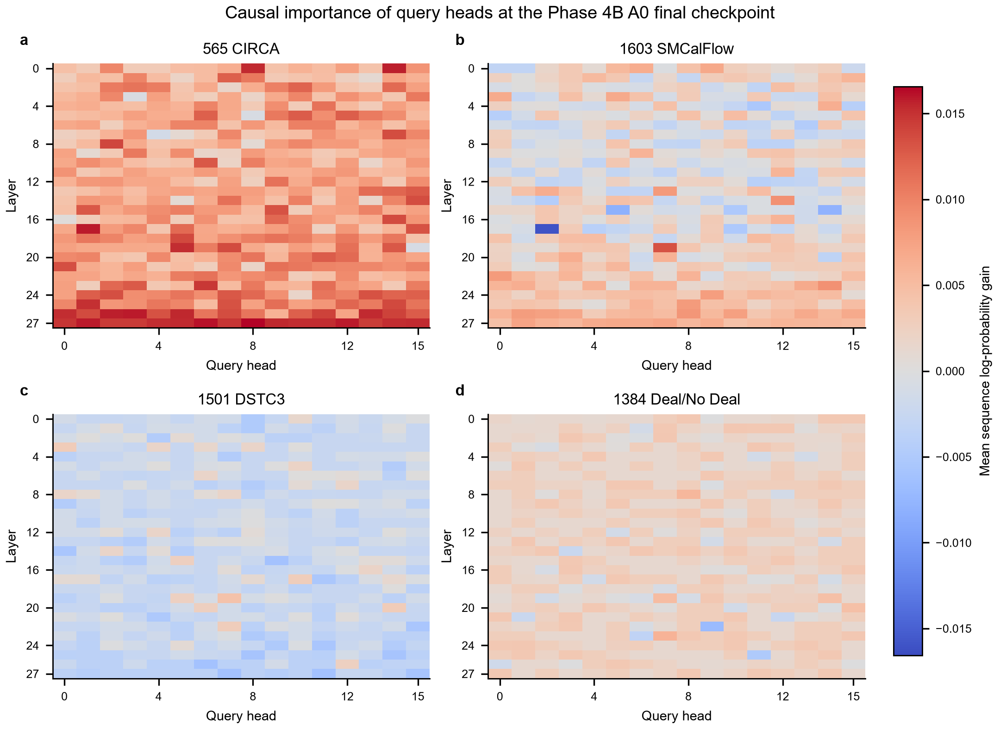
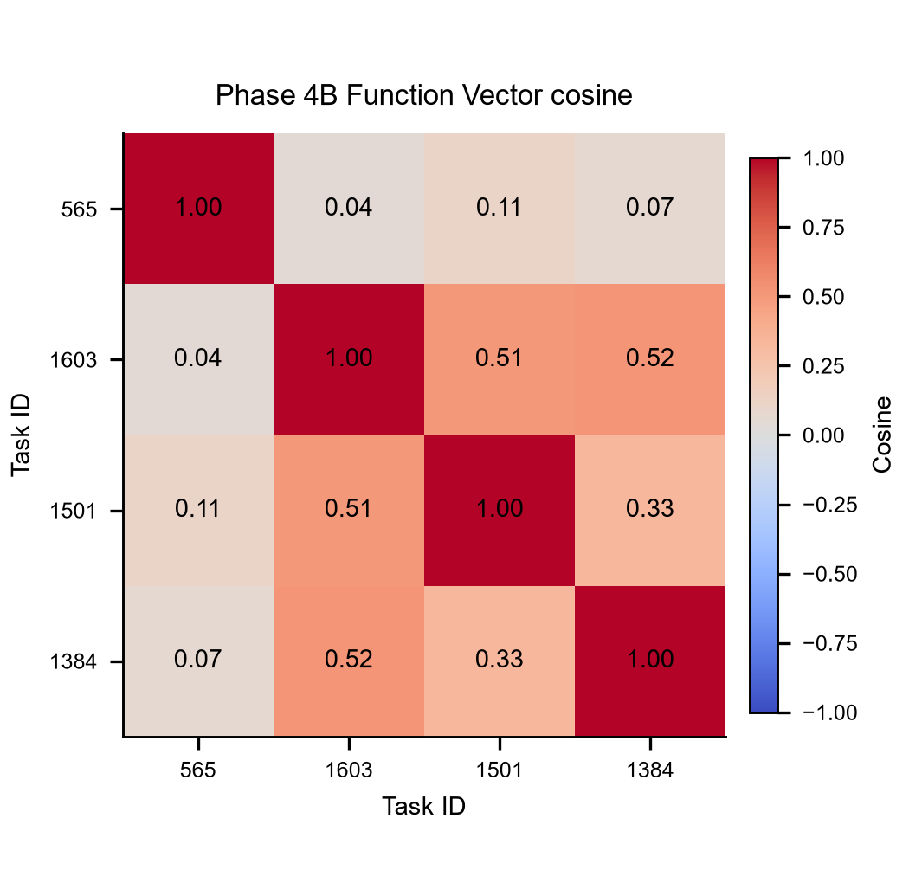
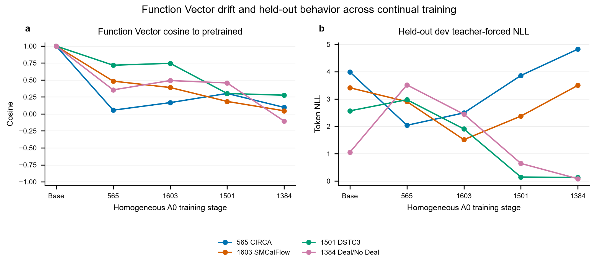

# Phase 5 Function Vector and Head Mechanism Analysis

## Method and data split

- Local Qwen3-0.6B checkpoints only; no network model loading, test split access, LoRA, replay, NAS, or training.
- Dev indices 0–9 build correct ICL activations and causal head rankings; indices 10–24 select FV intervention layer/strength; indices 25–49 are the locked final evaluation set (25 examples per task). The four ICL demonstrations come only from each task's train split.
- ICL shots: 4 (the prompt builder may reduce to 2 shots only when preserving the full task definition and the 2048-token budget requires it). Top-K: 10. Head-patch batch size: 8.
- Qwen3 uses 16 query heads and 8 KV heads. Each query head has head_dim=128; per-head residual contributions use BF16-quantized inputs/weights and FP32 accumulation of the corresponding `o_proj.weight` column slice. This reconstructs the BF16 attention output within a measured relative-RMS tolerance; KV heads are not treated as independent output heads.
- The paper defines a causal effect as a probability difference for a correct answer. For these multi-token generation tasks, head ranking uses the paired change in reference sequence mean log-probability on a label-shuffled prompt. First-token probability effects are also reported. This is a sequence-level extension; it avoids underflow and does not redefine the ICL prompt or patch position.
- Published FV construction sums the mean last-token residual contribution of top-10 causal heads. The implementation uses that definition, with the GQA-aware query-head output projection described above.
- Reference: [Unlocking the Power of Function Vectors for Characterizing and Mitigating Catastrophic Forgetting in Continual Instruction Tuning (ICLR 2025)](https://proceedings.iclr.cc/paper_files/paper/2025/file/74fc5575632191d96881d8015f79dde3-Paper-Conference.pdf).

## Checkpoint trajectory

The homogeneous A0 checkpoint trail supplies the pretrained model plus checkpoints after tasks 565, 1603, 1501 and 1384. Global causal scans are run at the pretrained and post-task-4 endpoints; intermediate post-task checkpoints are re-ranked within the union of their endpoint top-10 heads. The Phase 4B A0/S1/seed-10 final checkpoint receives a separate full 448-head scan and supplies the intervention vectors. Intermediate snapshots are from the retained homogeneous baseline trajectory, not intermediate saves from Phase 4B.

## Phase 4B final task vectors

| Task | Top-10 query heads (layer, head) | FV L2 norm |
|---|---|---:|
| task565_circa_answer_generation | (27,8), (27,6), (17,1), (27,12), (26,3), (27,1), (0,14), (26,2), (27,9), (26,5) | 22.8054 |
| task1603_smcalflow_sentence_generation | (19,7), (14,12), (23,14), (26,8), (13,7), (25,8), (22,0), (26,1), (24,9), (26,10) | 33.9240 |
| task1501_dstc3_answer_generation | (19,7), (20,14), (3,0), (17,10), (22,7), (20,6), (15,5), (19,5), (26,12), (5,10) | 56.6270 |
| task1384_deal_or_no_dialog_classification | (23,7), (8,8), (19,7), (20,15), (19,14), (24,1), (2,3), (13,5), (23,15), (21,0) | 62.2005 |

## Cross-task FV similarity and head overlap

The first and last columns compare pretrained and Phase 4B final task vectors. Head overlap counts are intersections of the task-specific top-10 query heads.

| Task pair | Pretrained FV cosine | Phase 4B FV cosine | Pretrained top-10 overlap | Phase 4B top-10 overlap |
|---|---:|---:|---:|---:|
| task565_circa_answer_generation / task1603_smcalflow_sentence_generation | 0.759 | 0.040 | 5/10 | 0/10 |
| task565_circa_answer_generation / task1501_dstc3_answer_generation | 0.204 | 0.112 | 3/10 | 0/10 |
| task565_circa_answer_generation / task1384_deal_or_no_dialog_classification | -0.034 | 0.068 | 2/10 | 0/10 |
| task1603_smcalflow_sentence_generation / task1501_dstc3_answer_generation | 0.234 | 0.505 | 3/10 | 1/10 |
| task1603_smcalflow_sentence_generation / task1384_deal_or_no_dialog_classification | -0.099 | 0.521 | 1/10 | 1/10 |
| task1501_dstc3_answer_generation / task1384_deal_or_no_dialog_classification | -0.289 | 0.334 | 0/10 | 1/10 |

### Final-vector drift from pretrained

| Task | Cosine to pretrained FV | Relative L2 drift |
|---|---:|---:|
| task565_circa_answer_generation | 0.119 | 1.005 |
| task1603_smcalflow_sentence_generation | 0.045 | 1.048 |
| task1501_dstc3_answer_generation | -0.102 | 1.193 |
| task1384_deal_or_no_dialog_classification | 0.371 | 1.097 |

## Stage-wise held-out behavior and FV drift

| A0 stage | Task | Token NLL | ROUGE-L | Accuracy | Yes share | No share | Yes/No collapse |
|---|---|---:|---:|---:|---:|---:|---:|
| pretrained | task565_circa_answer_generation | 3.9899 | 0.1972 | — | 0.5200 | 0.1600 | 0.5200 |
| pretrained | task1603_smcalflow_sentence_generation | 3.4124 | 0.1739 | — | 0.0000 | 0.0000 | 0.0000 |
| pretrained | task1501_dstc3_answer_generation | 2.5688 | — | 0.8000 | 0.0000 | 1.0000 | 1.0000 |
| pretrained | task1384_deal_or_no_dialog_classification | 1.0536 | — | 0.8800 | 0.9200 | 0.0800 | 0.9200 |
| homogeneous_stage_1 | task565_circa_answer_generation | 2.0403 | 0.2347 | — | 0.0000 | 0.0000 | 0.0000 |
| homogeneous_stage_1 | task1603_smcalflow_sentence_generation | 2.9068 | 0.1214 | — | 0.0000 | 0.0000 | 0.0000 |
| homogeneous_stage_1 | task1501_dstc3_answer_generation | 2.9760 | — | 0.0000 | 0.0000 | 0.0000 | 0.0000 |
| homogeneous_stage_1 | task1384_deal_or_no_dialog_classification | 3.5174 | — | 0.0000 | 0.0000 | 0.0000 | 0.0000 |
| homogeneous_stage_2 | task565_circa_answer_generation | 2.4932 | 0.0566 | — | 0.0800 | 0.0000 | 0.0800 |
| homogeneous_stage_2 | task1603_smcalflow_sentence_generation | 1.5136 | 0.2076 | — | 0.2000 | 0.0400 | 0.2000 |
| homogeneous_stage_2 | task1501_dstc3_answer_generation | 1.9058 | — | 0.0800 | 0.0800 | 0.0400 | 0.0800 |
| homogeneous_stage_2 | task1384_deal_or_no_dialog_classification | 2.4463 | — | 0.0000 | 0.0000 | 0.0000 | 0.0000 |
| homogeneous_stage_3 | task565_circa_answer_generation | 3.8619 | 0.0000 | — | 0.0000 | 1.0000 | 1.0000 |
| homogeneous_stage_3 | task1603_smcalflow_sentence_generation | 2.3755 | 0.0304 | — | 0.0000 | 1.0000 | 1.0000 |
| homogeneous_stage_3 | task1501_dstc3_answer_generation | 0.1461 | — | 0.9200 | 0.1200 | 0.8800 | 0.8800 |
| homogeneous_stage_3 | task1384_deal_or_no_dialog_classification | 0.6445 | — | 0.2000 | 0.0000 | 1.0000 | 1.0000 |
| homogeneous_stage_4 | task565_circa_answer_generation | 4.8259 | 0.0000 | — | 1.0000 | 0.0000 | 1.0000 |
| homogeneous_stage_4 | task1603_smcalflow_sentence_generation | 3.5005 | 0.0136 | — | 0.9600 | 0.0400 | 0.9600 |
| homogeneous_stage_4 | task1501_dstc3_answer_generation | 0.1329 | — | 0.8400 | 0.2800 | 0.7200 | 0.7200 |
| homogeneous_stage_4 | task1384_deal_or_no_dialog_classification | 0.0847 | — | 0.9200 | 0.8800 | 0.1200 | 0.8800 |

Descriptive Pearson correlations across the five homogeneous A0 stages (n=5):
- task565_circa_answer_generation: FV drift vs. held-out token NLL = -0.320.
- task1603_smcalflow_sentence_generation: FV drift vs. held-out token NLL = -0.200.
- task1501_dstc3_answer_generation: FV drift vs. held-out token NLL = -0.901.
- task1384_deal_or_no_dialog_classification: FV drift vs. held-out token NLL = -0.174.

Head scores, stage-specific top-10 lists, the fixed dev split, and raw per-query patch effects are in results/phase5/fv/. Figure exports, source tables, and the rendered QA record are under figures/phase5/, results/phase5/figure_data/, and reports/phase5_figure_qa.md.

## Figures

The head heatmap uses one shared, zero-centered color scale across all four tasks. The cosine matrix uses short task IDs; their display-name key is recorded in the figure QA note.







## FV intervention tuning and held-out results

Tuning chose residual block layer 5 (0-based) and coefficient 1.0. The selection objective is the mean teacher-forced token NLL of the two old generation tasks under `source FV − latest classifier FV`, averaged over tune indices 10–24.

| Task | Condition | ROUGE-L | Token-F1 | Accuracy | Teacher-forced token NLL | Ref first-token P | Mean output tokens | Yes share | No share | Collapse |
|---|---|---:|---:|---:|---:|---:|---:|---:|---:|---:|
| task565_circa_answer_generation | baseline | 0.0000 | 0.0000 | — | 5.1087 | 1.043e-05 | 2.0000 | 1.0000 | 0.0000 | 1.0000 |
| task565_circa_answer_generation | source_fv | 0.0000 | 0.0000 | — | 5.1806 | 9.686e-06 | 2.0000 | 1.0000 | 0.0000 | 1.0000 |
| task565_circa_answer_generation | subtract_latest_classifier_fv | 0.0000 | 0.0000 | — | 5.0367 | 1.402e-05 | 2.0000 | 1.0000 | 0.0000 | 1.0000 |
| task565_circa_answer_generation | combined_source_minus_latest | 0.0000 | 0.0000 | — | 5.0550 | 1.187e-05 | 2.0000 | 1.0000 | 0.0000 | 1.0000 |
| task565_circa_answer_generation | random_norm_matched | 0.0000 | 0.0000 | — | 4.8493 | 6.642e-05 | 2.0000 | 1.0000 | 0.0000 | 1.0000 |
| task565_circa_answer_generation | unrelated_fv | 0.0000 | 0.0000 | — | 4.5211 | 7.275e-04 | 2.0000 | 1.0000 | 0.0000 | 1.0000 |
| task1603_smcalflow_sentence_generation | baseline | 0.0136 | 0.0136 | — | 2.5246 | 1.004e-01 | 2.0000 | 0.9200 | 0.0800 | 0.9200 |
| task1603_smcalflow_sentence_generation | source_fv | 0.0136 | 0.0136 | — | 2.4637 | 1.143e-01 | 2.0000 | 0.9200 | 0.0800 | 0.9200 |
| task1603_smcalflow_sentence_generation | subtract_latest_classifier_fv | 0.0136 | 0.0136 | — | 2.5145 | 1.206e-01 | 2.0000 | 0.9600 | 0.0400 | 0.9600 |
| task1603_smcalflow_sentence_generation | combined_source_minus_latest | 0.0090 | 0.0090 | — | 2.4673 | 1.348e-01 | 2.0000 | 0.8400 | 0.1600 | 0.8400 |
| task1603_smcalflow_sentence_generation | random_norm_matched | 0.0136 | 0.0136 | — | 2.4836 | 1.152e-01 | 2.0000 | 1.0000 | 0.0000 | 1.0000 |
| task1603_smcalflow_sentence_generation | unrelated_fv | 0.0136 | 0.0136 | — | 2.6556 | 2.525e-03 | 2.0000 | 0.9600 | 0.0400 | 0.9600 |
| task1501_dstc3_answer_generation | baseline | — | — | 0.6400 | 0.2256 | 6.242e-01 | 2.0000 | 0.5600 | 0.4400 | 0.5600 |
| task1501_dstc3_answer_generation | source_fv | — | — | 0.4800 | 1.5257 | 1.343e-02 | 2.0000 | 0.7200 | 0.2800 | 0.7200 |
| task1501_dstc3_answer_generation | subtract_latest_classifier_fv | — | — | 0.5200 | 0.2391 | 5.260e-01 | 2.0000 | 0.6800 | 0.3200 | 0.6800 |
| task1501_dstc3_answer_generation | combined_source_minus_latest | — | — | 0.6000 | 0.2390 | 5.126e-01 | 2.0000 | 0.6000 | 0.4000 | 0.6000 |
| task1501_dstc3_answer_generation | random_norm_matched | — | — | 0.2000 | 0.6242 | 2.350e-01 | 2.0000 | 1.0000 | 0.0000 | 1.0000 |
| task1501_dstc3_answer_generation | unrelated_fv | — | — | 0.6400 | 0.2346 | 6.147e-01 | 2.0000 | 0.5600 | 0.4400 | 0.5600 |
| task1384_deal_or_no_dialog_classification | baseline | — | — | 0.9600 | 0.0730 | 8.414e-01 | 2.0000 | 0.8400 | 0.1600 | 0.8400 |
| task1384_deal_or_no_dialog_classification | source_fv | — | — | 0.8800 | 0.3234 | 4.403e-01 | 1.9600 | 0.8400 | 0.1200 | 0.8400 |
| task1384_deal_or_no_dialog_classification | subtract_latest_classifier_fv | — | — | 0.9600 | 0.1054 | 7.479e-01 | 2.0000 | 0.8400 | 0.1600 | 0.8400 |
| task1384_deal_or_no_dialog_classification | combined_source_minus_latest | — | — | 0.9600 | 0.0730 | 8.414e-01 | 2.0000 | 0.8400 | 0.1600 | 0.8400 |
| task1384_deal_or_no_dialog_classification | random_norm_matched | — | — | 0.8800 | 0.1040 | 7.877e-01 | 2.0000 | 0.9200 | 0.0800 | 0.9200 |
| task1384_deal_or_no_dialog_classification | unrelated_fv | — | — | 0.9600 | 0.0852 | 8.019e-01 | 2.0000 | 0.8400 | 0.1600 | 0.8400 |

### Paired held-out effects

Percentile-bootstrap 95% intervals compare each condition with its same-query baseline (25 examples per task). Lower NLL and higher generation/classification scores are improvements. These small-sample intervals are exploratory and are not multiplicity-adjusted.

| Task | Condition | Metric | Mean Δ | 95% CI |
|---|---|---|---:|---:|
| task565_circa_answer_generation | combined_source_minus_latest | per_example_token_nll | -0.0526 | [-0.0763, -0.0286] |
| task565_circa_answer_generation | combined_source_minus_latest | rouge_l_f1 | 0.0000 | [0.0000, 0.0000] |
| task565_circa_answer_generation | combined_source_minus_latest | token_f1 | 0.0000 | [0.0000, 0.0000] |
| task565_circa_answer_generation | combined_source_minus_latest | yes_no_collapse_rate | 0.0000 | [0.0000, 0.0000] |
| task565_circa_answer_generation | random_norm_matched | per_example_token_nll | -0.2708 | [-0.3191, -0.2287] |
| task565_circa_answer_generation | random_norm_matched | rouge_l_f1 | 0.0000 | [0.0000, 0.0000] |
| task565_circa_answer_generation | random_norm_matched | token_f1 | 0.0000 | [0.0000, 0.0000] |
| task565_circa_answer_generation | random_norm_matched | yes_no_collapse_rate | 0.0000 | [0.0000, 0.0000] |
| task565_circa_answer_generation | source_fv | per_example_token_nll | 0.0756 | [0.0622, 0.0898] |
| task565_circa_answer_generation | source_fv | rouge_l_f1 | 0.0000 | [0.0000, 0.0000] |
| task565_circa_answer_generation | source_fv | token_f1 | 0.0000 | [0.0000, 0.0000] |
| task565_circa_answer_generation | source_fv | yes_no_collapse_rate | 0.0000 | [0.0000, 0.0000] |
| task565_circa_answer_generation | subtract_latest_classifier_fv | per_example_token_nll | -0.0726 | [-0.0903, -0.0535] |
| task565_circa_answer_generation | subtract_latest_classifier_fv | rouge_l_f1 | 0.0000 | [0.0000, 0.0000] |
| task565_circa_answer_generation | subtract_latest_classifier_fv | token_f1 | 0.0000 | [0.0000, 0.0000] |
| task565_circa_answer_generation | subtract_latest_classifier_fv | yes_no_collapse_rate | 0.0000 | [0.0000, 0.0000] |
| task565_circa_answer_generation | unrelated_fv | per_example_token_nll | -0.6095 | [-0.6892, -0.5312] |
| task565_circa_answer_generation | unrelated_fv | rouge_l_f1 | 0.0000 | [0.0000, 0.0000] |
| task565_circa_answer_generation | unrelated_fv | token_f1 | 0.0000 | [0.0000, 0.0000] |
| task565_circa_answer_generation | unrelated_fv | yes_no_collapse_rate | 0.0000 | [0.0000, 0.0000] |
| task1603_smcalflow_sentence_generation | combined_source_minus_latest | per_example_token_nll | -0.0641 | [-0.0935, -0.0316] |
| task1603_smcalflow_sentence_generation | combined_source_minus_latest | rouge_l_f1 | -0.0047 | [-0.0300, 0.0160] |
| task1603_smcalflow_sentence_generation | combined_source_minus_latest | token_f1 | -0.0047 | [-0.0300, 0.0160] |
| task1603_smcalflow_sentence_generation | combined_source_minus_latest | yes_no_collapse_rate | -0.0809 | [-0.2000, 0.0000] |
| task1603_smcalflow_sentence_generation | random_norm_matched | per_example_token_nll | -0.0658 | [-0.1031, -0.0299] |
| task1603_smcalflow_sentence_generation | random_norm_matched | rouge_l_f1 | 0.0000 | [0.0000, 0.0000] |
| task1603_smcalflow_sentence_generation | random_norm_matched | token_f1 | 0.0000 | [0.0000, 0.0000] |
| task1603_smcalflow_sentence_generation | random_norm_matched | yes_no_collapse_rate | 0.0804 | [0.0000, 0.2000] |
| task1603_smcalflow_sentence_generation | source_fv | per_example_token_nll | -0.1128 | [-0.1840, -0.0562] |
| task1603_smcalflow_sentence_generation | source_fv | rouge_l_f1 | 0.0000 | [0.0000, 0.0000] |
| task1603_smcalflow_sentence_generation | source_fv | token_f1 | 0.0000 | [0.0000, 0.0000] |
| task1603_smcalflow_sentence_generation | source_fv | yes_no_collapse_rate | 0.0000 | [0.0000, 0.0000] |
| task1603_smcalflow_sentence_generation | subtract_latest_classifier_fv | per_example_token_nll | -0.0107 | [-0.0418, 0.0279] |
| task1603_smcalflow_sentence_generation | subtract_latest_classifier_fv | rouge_l_f1 | 0.0000 | [0.0000, 0.0000] |
| task1603_smcalflow_sentence_generation | subtract_latest_classifier_fv | token_f1 | 0.0000 | [0.0000, 0.0000] |
| task1603_smcalflow_sentence_generation | subtract_latest_classifier_fv | yes_no_collapse_rate | 0.0411 | [0.0000, 0.1200] |
| task1603_smcalflow_sentence_generation | unrelated_fv | per_example_token_nll | 0.1621 | [0.1211, 0.2065] |
| task1603_smcalflow_sentence_generation | unrelated_fv | rouge_l_f1 | 0.0000 | [0.0000, 0.0000] |
| task1603_smcalflow_sentence_generation | unrelated_fv | token_f1 | 0.0000 | [0.0000, 0.0000] |
| task1603_smcalflow_sentence_generation | unrelated_fv | yes_no_collapse_rate | 0.0400 | [0.0000, 0.1200] |
| task1501_dstc3_answer_generation | combined_source_minus_latest | per_example_token_nll | 0.0135 | [-0.0428, 0.0659] |
| task1501_dstc3_answer_generation | combined_source_minus_latest | correct | -0.0400 | [-0.1200, 0.0000] |
| task1501_dstc3_answer_generation | combined_source_minus_latest | yes_no_collapse_rate | 0.0226 | [-0.0800, 0.1200] |
| task1501_dstc3_answer_generation | random_norm_matched | per_example_token_nll | 0.3986 | [0.2949, 0.4958] |
| task1501_dstc3_answer_generation | random_norm_matched | correct | -0.4400 | [-0.6400, -0.2400] |
| task1501_dstc3_answer_generation | random_norm_matched | yes_no_collapse_rate | 0.4052 | [0.2400, 0.4800] |
| task1501_dstc3_answer_generation | source_fv | per_example_token_nll | 1.3002 | [1.2610, 1.3429] |
| task1501_dstc3_answer_generation | source_fv | correct | -0.1600 | [-0.3200, -0.0400] |
| task1501_dstc3_answer_generation | source_fv | yes_no_collapse_rate | 0.1256 | [-0.0400, 0.2800] |
| task1501_dstc3_answer_generation | subtract_latest_classifier_fv | per_example_token_nll | 0.0136 | [-0.0342, 0.0573] |
| task1501_dstc3_answer_generation | subtract_latest_classifier_fv | correct | -0.1200 | [-0.2800, 0.0000] |
| task1501_dstc3_answer_generation | subtract_latest_classifier_fv | yes_no_collapse_rate | 0.0882 | [-0.0800, 0.2400] |
| task1501_dstc3_answer_generation | unrelated_fv | per_example_token_nll | 0.0091 | [0.0035, 0.0154] |
| task1501_dstc3_answer_generation | unrelated_fv | correct | 0.0000 | [0.0000, 0.0000] |
| task1501_dstc3_answer_generation | unrelated_fv | yes_no_collapse_rate | 0.0000 | [0.0000, 0.0000] |
| task1384_deal_or_no_dialog_classification | combined_source_minus_latest | per_example_token_nll | 0.0000 | [0.0000, 0.0000] |
| task1384_deal_or_no_dialog_classification | combined_source_minus_latest | correct | 0.0000 | [0.0000, 0.0000] |
| task1384_deal_or_no_dialog_classification | combined_source_minus_latest | yes_no_collapse_rate | 0.0000 | [0.0000, 0.0000] |
| task1384_deal_or_no_dialog_classification | random_norm_matched | per_example_token_nll | 0.0310 | [0.0042, 0.0633] |
| task1384_deal_or_no_dialog_classification | random_norm_matched | correct | -0.0800 | [-0.2000, 0.0000] |
| task1384_deal_or_no_dialog_classification | random_norm_matched | yes_no_collapse_rate | 0.0797 | [0.0000, 0.2000] |
| task1384_deal_or_no_dialog_classification | source_fv | per_example_token_nll | 0.2503 | [0.1979, 0.3095] |
| task1384_deal_or_no_dialog_classification | source_fv | correct | -0.0800 | [-0.2000, 0.0000] |
| task1384_deal_or_no_dialog_classification | source_fv | yes_no_collapse_rate | 0.0010 | [-0.1200, 0.1200] |
| task1384_deal_or_no_dialog_classification | subtract_latest_classifier_fv | per_example_token_nll | 0.0324 | [0.0072, 0.0475] |
| task1384_deal_or_no_dialog_classification | subtract_latest_classifier_fv | correct | 0.0000 | [0.0000, 0.0000] |
| task1384_deal_or_no_dialog_classification | subtract_latest_classifier_fv | yes_no_collapse_rate | 0.0000 | [0.0000, 0.0000] |
| task1384_deal_or_no_dialog_classification | unrelated_fv | per_example_token_nll | 0.0122 | [-0.0008, 0.0219] |
| task1384_deal_or_no_dialog_classification | unrelated_fv | correct | 0.0000 | [0.0000, 0.0000] |
| task1384_deal_or_no_dialog_classification | unrelated_fv | yes_no_collapse_rate | 0.0000 | [0.0000, 0.0000] |

All intervention conditions are evaluated on the same locked 25-example/task dev evaluation subset. `source FV` is the evaluated task's vector. `target FV subtraction` removes task 1384's vector. `combined` adds the evaluated task FV and subtracts task 1384. The random vector matches the combined-vector norm on generation tasks and the task-vector norm on classification tasks; unrelated vectors use the opposite task family (generation vs. classification).

## Interpretation limits

Activation patching is causal evidence for the selected head representation on the constructed ICL prompts. Similarity and drift relationships are correlational. The benchmark prompts are short demonstrations drawn from train plus a query from dev; this measures elicited task functions and does not by itself prove which latent function the zero-shot classifier/generator activates in deployment. Sample counts are small, so report effect sizes and per-example files alongside aggregate means.

## Findings and architecture recommendation

1. **FV recovery:** Neither old generation task shows a reliable recovery in generated text. Task 565 remains at ROUGE-L/Token-F1 0 and 2 output tokens under every condition. For task 1603, combined source-minus-classifier FV changes ROUGE-L by -0.0047 (95% CI [-0.0300, 0.0160]); generated length remains 2 tokens and the Yes/No-collapse change has a bootstrap interval that reaches zero. Some teacher-forced NLL changes are significant, but random or unrelated vectors can improve NLL as much or more, so NLL alone is not task-specific recovery evidence.
2. **Forgetting mechanism:** The old generation FVs drift strongly from pretrained (cosines 0.119 and 0.045; relative L2 drift about 1.0), and task 565's final top-10 head set is disjoint from the other three tasks. Yet drift-to-NLL correlations across five stages are weak for the two generation tasks and FV injection does not restore their text outputs. The evidence therefore favors impaired old-task conditional generation/output behavior over activation bias as a sufficient explanation; activation bias remains a measurable contributing factor, not a demonstrated sole cause.
3. **A1 branch:** The paired direct-path test is in `reports/phase5_a1_ablation.md`. A1 gates are very small and zeroing them changes few logits/predictions; A1-vs-A0 differences also include the distinct training trajectory, so they do not establish a direct branch benefit.
4. **Next architecture:** Prioritize a small **Conditional Routing** study with task-conditioned gates over the identified head groups, and include Head Isolation as a control. Top-head overlap is zero for task 565 against all other tasks after Phase 4B, while task 1603 retains some FV similarity to both classification tasks; a task-conditioned route can protect the distinct path while retaining shared capacity. The evidence is enough to define a constrained Task-Aware NAS hypothesis, but not to claim a validated architecture benefit or launch a broad NAS search before the routing pilot.

To regenerate only the figures from cached results without rerunning model inference:

    .\conda-env\python.exe scripts\plot_phase5_figures.py

## Reproduction

```powershell
.\conda-env\python.exe scripts\run_phase5_fv.py
```
